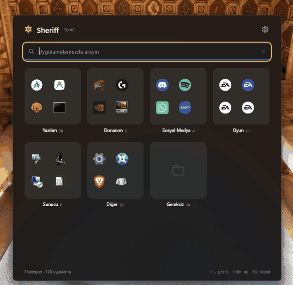
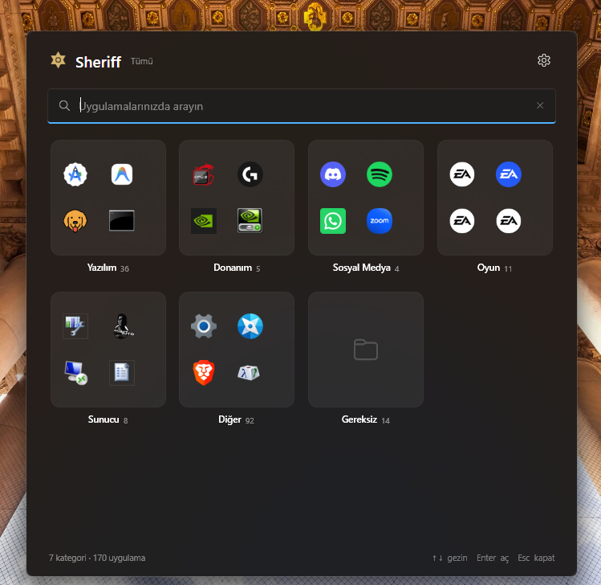

  <h1>Sheriff</h1>
  
<strong>A fast, categorized, keyboard-first app launcher for Windows 11.</strong>

  

    
    
    
    
  

  

    <a href="https://github.com/mustafawiped/Sheriff/releases/latest"><strong>Download for Windows</strong></a>
    &nbsp;·&nbsp;
    <a href="#quick-start">Quick start</a>
    &nbsp;·&nbsp;
    <a href="#privacy">Privacy</a>
  

  
  
The animation highlights the search field and category cards in sequence.

---

## Take a look at Sheriff

This screenshot is from the real Sheriff interface running on Windows. Categories and app counts vary depending on what is installed on each PC.

## Get to your apps in a keystroke

Sheriff scans Start menu shortcuts and packaged Windows apps, organizes them into clear categories, and opens them from one always-ready panel. Open it from the Sheriff taskbar icon, the system tray, or the <kbd>Ctrl</kbd>+<kbd>Alt</kbd>+<kbd>Space</kbd> shortcut.

| Feature | What it does |
| --- | --- |
| **Instant search** | Filter by app name, publisher, or description as you type. |
| **Square category cards** | Find apps in tiles inspired by the Windows 11 Start experience, then launch directly from an app preview. |
| **Hover to organize** | Hover over an app for 450 ms to reveal **Move** and **Remove from category** actions. Restore removed apps from Settings. |
| **Drag and drop** | Move an app by dropping it on a category card or into a category’s detail view. |
| **Smart ranking** | Usage history and pins bring frequently used apps closer. |
| **Windows integration** | Start menu shortcuts, AppsFolder apps, a tray menu, and optional launch at Windows startup. |

## Quick start

1. [**Download Sheriff.exe from the v1.0.0 release**](https://github.com/mustafawiped/Sheriff/releases/latest).
2. Save the EXE in a permanent folder and run it.
3. Press <kbd>Ctrl</kbd>+<kbd>Alt</kbd>+<kbd>Space</kbd> to open the panel, then type an app name or publisher.
4. Select an app preview to launch it, or click the empty area of a category card to open its details.

> **Tip:** Click outside the panel or press <kbd>Esc</kbd> to hide it. Sheriff stays ready in the background.

### Keyboard and mouse

| Action | Control |
| --- | --- |
| Show or hide the panel | <kbd>Ctrl</kbd>+<kbd>Alt</kbd>+<kbd>Space</kbd>, left-click the tray icon, or run the pinned EXE |
| Navigate results | <kbd>↑</kbd> / <kbd>↓</kbd> |
| Launch an app | <kbd>Enter</kbd> or click its icon |
| Close the panel | <kbd>Esc</kbd> or click another window |
| Move or remove an app | Hover over its icon for 450 ms, then choose an action |
| Open a category | Click the empty area of a category card |
| Categorize an app | Drag it onto a category card or use its right-click menu |

## How categorization works

Sheriff starts with local, user-controlled rules:

~~~mermaid
flowchart TD
    A[App discovered] --> B{Manually assigned category?}
    B -- Yes --> U[User-selected category]
    B -- No --> J{Helper or uninstaller entry?}
    J -- Yes --> X[Unwanted]
    J -- No --> K{Known app rule?}
    K -- Yes --> C[Known category]
    K -- No --> P[Publisher and folder rules]
    P --> W[Name and description keyword scores]
    W --> L{LLM fallback enabled?}
    L -- Yes --> O[Optional OpenAI classification]
    L -- No --> D[Other]
    O --> D
~~~

- A manually assigned category takes precedence over automatic classification.
- The app catalog contains 384 known-app rules. EXE and AUMID matches are checked before publisher rules.
- **Unwanted** keeps helper entries separate. It has no app preview on the home screen, and its items are collapsed by default in the detail view.
- Usage scores decay with a 30-day half-life; pinning adds a lasting ranking bonus.

## Privacy

Sheriff stores its app catalog, preferences, icon cache, and usage ranking locally under <code>%LocalAppData%\Sheriff</code>.

Optional LLM classification is **off by default**. If you enable it in Settings and enter your own API key, only the **name and publisher** of an app that local rules could not classify are sent to <code>https://api.openai.com/v1/chat/completions</code>. File paths, command-line arguments, descriptions, icons, and usage history are not sent. The API key is protected with Windows DPAPI. The LLM cannot override a manually assigned category or the Unwanted filter.

| Local data | Contents |
| --- | --- |
| <code>config.json</code> | Categories, category preferences, pins, hidden apps, and settings |
| <code>apps.json</code> | Cache from the most recent app scan |
| <code>icons/</code> | Icons extracted from the Windows Shell |
| <code>usage.db</code> | Launch history and ranking data from Sheriff |
| <code>llm-cache.json</code> | Accepted classification results when the LLM fallback is enabled |

## Architecture

~~~mermaid
flowchart LR
    User[Keyboard, tray, or taskbar] --> App[WPF panel · single window]
    App --> Core[Scanner and categorization]
    Core --> Start[Start menu shortcuts]
    Core --> Store[Windows AppsFolder]
    Core --> Rank[Usage ranking]
    Rank --> DB[(SQLite)]
    Core --> Config[(JSON settings and cache)]
    Watch[File and Shell change watchers] --> Core
    Core -. optional app name and publisher .-> OpenAI[OpenAI Chat Completions]
~~~

- **Sheriff.App:** .NET 8 WPF interface, single-instance startup, named pipe, global shortcut, tray, and Windows integration.
- **Sheriff.Core:** Windows app scanner, category rules, known apps, and usage-ranking model.
- **Sheriff.Data:** Atomic JSON storage, DPAPI-protected API key, and SQLite usage data.
- **Sheriff.Tests:** xUnit tests.

The main window stays in memory so it is ready when you need it. Start menu <code>.lnk</code> files and Store apps are scanned in the background; icons are served from a cache. Launching a second Sheriff instance asks the running panel to show or hide instead of opening another window.

## Development

Requirements: Windows 11 x64 and the .NET 8 SDK. An internet connection is needed for the initial NuGet restore.

~~~powershell
.\scripts\build.ps1
~~~

To run the tests directly:

~~~powershell
dotnet test Sheriff.Tests\Sheriff.Tests.csproj -c Release
~~~

To create a self-contained, single-file Windows build:

~~~powershell
.\scripts\publish.ps1
~~~

The output is <code>artifacts\publish\win-x64\Sheriff.exe</code>; end users do not need a separate .NET installation. SQLite native components are bundled as well.

## Validation

- Release build: 0 warnings, 0 errors.
- xUnit: **113 tests passed**.
- <code>--ui-smoke</code> verifies the category overview and detail view, hover actions, preview launch event, and removal record with synthetic apps.
- The performance log records <code>SHOW_RETURN</code> and the first WPF <code>CompositionTarget.Rendering</code> callback as <code>SHOW_RENDER</code>. <code>SHOW_RENDER</code> does not measure physical presentation on screen. The 50 ms target was not remeasured after the last UI changes, so this README does not claim that the target is met.

## License

Sheriff is licensed under the MIT License. See [LICENSE](LICENSE) for the full text.

  One shortcut. Clear categories. The app you need.

