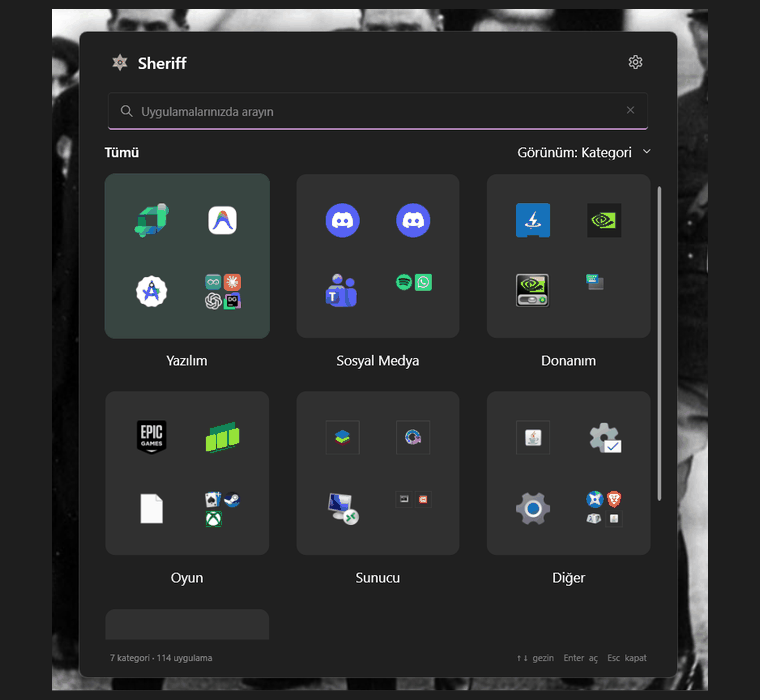

  <h1>Sheriff</h1>
  
<strong>A fast, categorized, keyboard-first app launcher for Windows 11.</strong>

  

    
    
    
    
  

  

    <a href="https://github.com/mustafawiped/Sheriff/releases/latest"><strong>Download for Windows</strong></a>
    &nbsp;·&nbsp;
    <a href="#quick-start">Quick start</a>
    &nbsp;·&nbsp;
    <a href="#privacy">Privacy</a>
  

  
  
Home → category details → Settings

---

## Take a look at Sheriff

This screenshot is from the real Sheriff interface running on Windows. Categories and app counts vary depending on what is installed on each PC.

## Get to your apps in a keystroke

Sheriff discovers Start menu shortcuts and packaged Windows apps, organizes them into clear categories, and opens them from one compact panel. Launch the pinned EXE to open Sheriff; its local app cache appears first, so you can start browsing without waiting for a fresh scan.

| Feature | What it does |
| --- | --- |
| **Instant search** | Filter by app name, publisher, or description as you type. |
| **Square category cards** | Browse Start-inspired category tiles and open an app with one click from its preview. |
| **Separate category windows** | Open a category in its own resizable window, search within it, and manage apps from each app’s context menu. |
| **Category customization** | Add, rename, enable, or disable categories, choose their colors, and assign apps with direct membership checkboxes. |
| **Automatic app filtering** | Installers, uninstallers, terminals, PowerShell, and Git tools stay off the home screen until enabled individually in Settings. |
| **Hover to organize** | Hover over an app for 450 ms to reveal **Move** and **Remove from category** actions. Restore removed apps from Settings. |
| **Drag and drop** | Move an app by dropping it on a category card. |
| **Smart ranking** | Usage history and pins bring frequently used apps closer. |
| **Windows integration** | Start menu shortcuts, Microsoft Store apps from AppsFolder, and optional launch at Windows startup. |
| **On-demand process** | Sheriff exits when you close the panel. Its catalog and icon cache stay on disk for the next launch. |
| **Clear, responsive motion** | Short animations support panel and category transitions and respect Windows reduced-motion settings. |
| **Cached icons and launch data** | Sheriff loads its saved catalog first, keeps higher-resolution icons in a local cache, and updates usage data per app. |

## Quick start

1. [**Download Sheriff.exe from the latest release**](https://github.com/mustafawiped/Sheriff/releases/latest).
2. Save the EXE in a permanent folder and run it.
3. Type an app name or publisher in the panel. Press <kbd>Ctrl</kbd>+<kbd>Alt</kbd>+<kbd>Space</kbd> while Sheriff is open to hide or show it.
4. Select an app preview to launch it, or click a category card to open its separate detail window.

> **Tip:** Click outside the panel or press <kbd>Esc</kbd> to close Sheriff completely. The next launch reads the saved catalog immediately. Opening a category starts a fresh scan while the panel is open; an empty cache is scanned on first launch.

### Keyboard and mouse

| Action | Control |
| --- | --- |
| Open Sheriff | Run the pinned EXE or enable **Start with Windows** in Settings |
| Hide or show the panel | <kbd>Ctrl</kbd>+<kbd>Alt</kbd>+<kbd>Space</kbd> while Sheriff is open |
| Navigate results | <kbd>↑</kbd> / <kbd>↓</kbd> |
| Launch an app | <kbd>Enter</kbd> or click its icon |
| Close the panel | <kbd>Esc</kbd> or click another window |
| Move or remove an app | Hover over its icon for 450 ms, then choose an action |
| Open a category | Click its card or the overflow preview to open the separate window |
| Categorize an app | Drag it onto a category card or use its right-click menu |
| Customize categories | Open **Settings → Categories → Edit categories** |
| Enable a filtered tool | Open **Settings → Automatically blocked** and select it |

## How categorization works

Sheriff starts with local, user-controlled rules:

~~~mermaid
flowchart TD
    A[App discovered] --> B{Automatically blocked tool?}
    B -- Yes --> H[Hidden from home]
    H --> E{Enabled in Settings?}
    E -- No --> S[Settings only]
    E -- Yes --> C{Manually assigned category?}
    B -- No --> C
    C -- Yes --> U[User-selected category]
    C -- No --> J{Unwanted helper entry?}
    J -- Yes --> X[Unwanted]
    J -- No --> K{Known app rule?}
    K -- Yes --> C[Known category]
    K -- No --> P[Publisher and folder rules]
    P --> W[Name and description keyword scores]
    W --> L{LLM fallback enabled?}
    L -- Yes --> O[Optional OpenAI classification]
    L -- No --> D[Other]
    O --> D
~~~

- A manually assigned category takes precedence over automatic classification.
- Installer and uninstaller entries, command shells, terminals, PowerShell, and Git utilities are hidden by default; each can be enabled in Settings.
- The category editor manages app membership, category names, visibility, and colors in one place.
- The app catalog contains 384 known-app rules. EXE and AUMID matches are checked before publisher rules.
- **Unwanted** keeps helper entries separate. It has no app preview on the home screen, and its items are collapsed by default in the detail view.
- Usage scores decay with a 30-day half-life; pinning adds a lasting ranking bonus.

## Privacy

Sheriff stores its app catalog, preferences, icon cache, and usage ranking locally under <code>%LocalAppData%\Sheriff</code>.

Optional LLM classification is **off by default**. If you enable it in Settings and enter your own API key, only the **name and publisher** of an app that local rules could not classify are sent to <code>https://api.openai.com/v1/chat/completions</code>. File paths, command-line arguments, descriptions, icons, and usage history are not sent. The API key is protected with Windows DPAPI. The LLM cannot override a manually assigned category or the Unwanted filter.

| Local data | Contents |
| --- | --- |
| <code>config.json</code> | Custom categories, app assignments, colors, pins, hidden apps, blocked-tool choices, and settings |
| <code>apps.json</code> | Cache from the most recent app scan |
| <code>icons/</code> | Icons extracted from the Windows Shell |
| <code>usage.db</code> | Launch history and ranking data from Sheriff |
| <code>llm-cache.json</code> | Accepted classification results when the LLM fallback is enabled |

## Architecture

~~~mermaid
flowchart LR
    User[Launch EXE or Windows startup] --> App[WPF panel · single instance]
    App --> Core[Scanner and categorization]
    Core --> Start[Start menu shortcuts]
    Core --> Store[Windows AppsFolder]
    Core --> Rank[Usage ranking]
    Rank --> DB[(SQLite)]
    Core --> Config[(JSON settings and cache)]
    Watch[File and Shell change watchers] --> Core
    Core -. optional app name and publisher .-> OpenAI[OpenAI Chat Completions]
~~~

- **Sheriff.App:** .NET 8 WPF interface, single-instance startup, named pipe, in-session global shortcut, and Windows integration.
- **Sheriff.Core:** Windows app scanner, category rules, known apps, and usage-ranking model.
- **Sheriff.Data:** Atomic JSON storage, DPAPI-protected API key, and SQLite usage data.
- **Sheriff.Tests:** xUnit tests.

The catalog loads from disk before the panel appears. With a populated cache, Sheriff waits until you open a category before scanning for newly installed apps; on a first launch with no cache, it starts scanning immediately. Category details open in a separate virtualized window, and search refreshes after typing pauses. Icons load from the local cache as their tiles appear. Closing the panel ends the process, so Sheriff uses no idle background memory. Launching a second Sheriff instance toggles the open panel instead of opening another window.

## Development

Requirements: Windows 11 x64 and the .NET 8 SDK. An internet connection is needed for the initial NuGet restore.

~~~powershell
.\scripts\build.ps1
~~~

To run the tests directly:

~~~powershell
dotnet test Sheriff.Tests\Sheriff.Tests.csproj -c Release
~~~

To create a self-contained, single-file Windows build:

~~~powershell
.\scripts\publish.ps1
~~~

The output is <code>artifacts\publish\win-x64\Sheriff.exe</code>; end users do not need a separate .NET installation. SQLite native components are bundled as well.

## Validation

- Release build: 0 warnings, 0 errors.
- <code>--ui-smoke</code> passes the category overview and separate detail window, hover actions, preview launch, category editor, and saved configuration checks.

## License

Sheriff is licensed under the MIT License. See [LICENSE](LICENSE) for the full text.

  One shortcut. Clear categories. The app you need.

