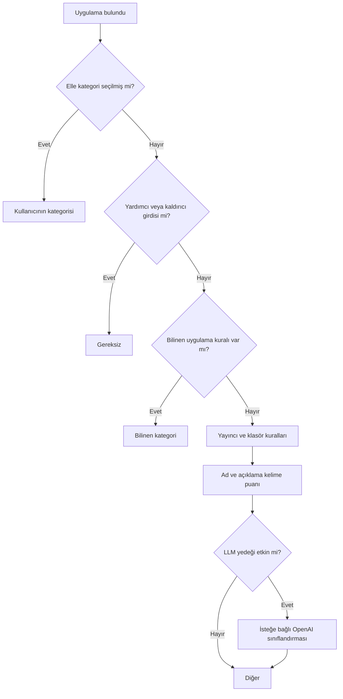
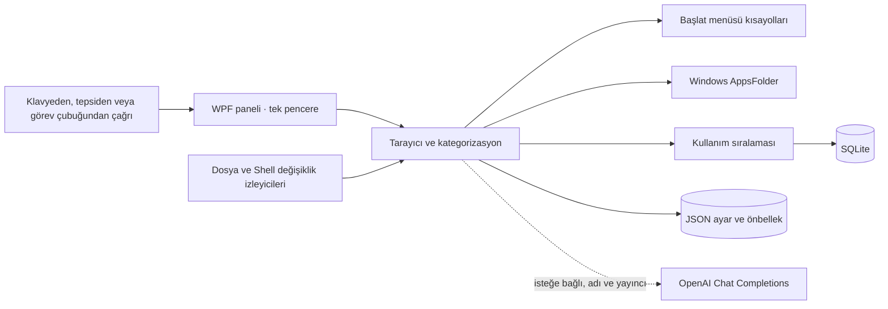

<div align="center">
  <h1>Sheriff</h1>
  <p><strong>Windows 11 için hızlı, kategorili ve klavyeden erişilebilen uygulama başlatıcısı.</strong></p>
  <p>
    
    
    
    <a href="https://github.com/mustafawiped/Sheriff/releases/latest"></a>
  </p>
  <p>
    <a href="https://github.com/mustafawiped/Sheriff/releases/latest"><strong>Windows sürümünü indir</strong></a>
    &nbsp;·&nbsp;
    <a href="#hizli-baslangic">Hızlı başlangıç</a>
    &nbsp;·&nbsp;
    <a href="#gizlilik">Gizlilik</a>
  </p>
  
  <p><sub>Animasyon, arama alanını ve kategori kartlarını sırayla vurgular.</sub></p>
</div>

---

## Sheriff'e göz atın

Aşağıdaki ekran görüntüsü Sheriff'in gerçek Windows arayüzünden alınmıştır. Kategoriler ve uygulama sayısı her bilgisayardaki kurulumlara göre değişir.


## Uygulamalarınıza tek hamlede ulaşın

Sheriff; Başlat menüsü kısayollarını ve paketli Windows uygulamalarını tarar, anlaşılır kategorilerde toplar ve her seferinde aynı hazır panelden açar. Görev çubuğundaki Sheriff simgesine, sistem tepsisine ya da `Ctrl+Alt+Space` kısayoluna basın.

| Özellik | Ne sağlar? |
| --- | --- |
| **Hızlı arama** | Uygulama adı, yayıncı veya açıklama yazarak anında filtreleyin. |
| **Kare kategori kartları** | Uygulamaları Windows 11 Başlat görünümüne benzer kutucuklarda bulun; kart içindeki önizleme simgesine basarak doğrudan açın. |
| **Beklet ve düzenle** | Uygulama üzerinde 450 ms bekleyince **Taşı** ve **Kategoriden kaldır** seçenekleri görünür. Kaldırdıklarınızı Ayarlar'dan geri alın. |
| **Sürükle ve bırak** | Bir uygulamayı kategori kartına veya kategori ayrıntısındaki satıra bırakarak konumunu değiştirin. |
| **Akıllı sıralama** | Kullanım geçmişi ve sabitlemeler sık kullandıklarınızı öne çıkarır. |
| **Windows entegrasyonu** | Başlat menüsü kısayolları, AppsFolder uygulamaları, tepsi menüsü ve isteğe bağlı Windows başlangıcı. |

## Hızlı başlangıç

1. [**v1.0.0 sürümünden `Sheriff.exe` dosyasını indirin**](https://github.com/mustafawiped/Sheriff/releases/latest).
2. EXE'yi kalıcı bir klasöre kaydedip çalıştırın.
3. `Ctrl+Alt+Space` ile paneli açın; uygulama adı veya yayıncı yazın.
4. Kategori kartındaki uygulama önizlemesine basın ya da kartın boş alanından kategori ayrıntısını açın.

> **İpucu:** Panel dışına tıklamak veya `Esc` tuşuna basmak paneli gizler; Sheriff arka planda hazır kalır.

### Kısayollar ve fare

| Eylem | Kontrol |
| --- | --- |
| Paneli aç/kapat | `Ctrl+Alt+Space`, tepsi simgesine sol tık veya sabitlenmiş EXE |
| Sonuçlarda gezin | `↑` / `↓` |
| Uygulamayı başlat | `Enter` veya uygulama simgesine tıklama |
| Paneli kapat | `Esc` ya da başka pencereye tıklama |
| Uygulamayı taşı/kaldır | Uygulama simgesinin üzerinde 450 ms bekleyip çıkan eylemi seçme |
| Kategoriyi aç | Kategori kartının boş alanına tıklama |
| Uygulamayı kategorile | Uygulamayı kategori kartına sürükleme veya sağ tık menüsünü kullanma |

## Kategorizasyon nasıl çalışır?

Sheriff sınıflandırmayı önce yerel ve kullanıcı kontrollü kurallarla yapar:



- Elle verilen kategori otomatik sınıflandırmadan önceliklidir.
- Uygulama kataloğunda 384 bilinen uygulama kuralı bulunur; EXE ve AUMID eşleşmeleri yayıncı kuralından önce değerlendirilir.
- **Gereksiz** yardımcı girdileri ayrı tutar; bu kategori ana ekranda uygulama simgesi önizlemesi göstermez ve ayrıntıda başlangıçta daraltılmıştır.
- Kullanım puanı 30 günlük yarı ömürle azalır; sabitleme kalıcı bir sıralama bonusu verir.

## Gizlilik

Sheriff uygulama kataloğunu, tercihleri, simge önbelleğini ve kullanım sıralamasını yerel olarak `%LocalAppData%\Sheriff` altında saklar.

İsteğe bağlı LLM sınıflandırması **varsayılan olarak kapalıdır**. Ayarlardan açıp kendi API anahtarınızı girdiğinizde, yalnızca yerel kurallarla sınıflandırılamayan uygulamanın **adı ve yayıncısı** `https://api.openai.com/v1/chat/completions` adresine gönderilir. Dosya yolu, komut satırı argümanları, açıklama, simge ve kullanım geçmişi gönderilmez. API anahtarı Windows DPAPI ile korunur. Elle verdiğiniz kategori ve Gereksiz filtresi LLM tarafından geçersiz kılınamaz.

| Yerel veri | İçerik |
| --- | --- |
| `config.json` | Kategoriler, kategori tercihleri, sabitlemeler, gizlenen uygulamalar ve ayarlar |
| `apps.json` | Son uygulama taramasının önbelleği |
| `icons/` | Windows Shell'den çıkarılan simge önbelleği |
| `usage.db` | Sheriff üzerinden başlatma geçmişi ve sıralama verisi |
| `llm-cache.json` | LLM yedeği açıksa kabul edilmiş sınıflandırma sonuçları |

## Mimari



- **Sheriff.App:** .NET 8 WPF arayüzü, tek örnekli açılış, named pipe, global kısayol, tepsi ve Windows entegrasyonu.
- **Sheriff.Core:** Windows uygulama tarayıcısı, kategori kuralları, bilinen uygulamalar ve kullanım puanlama modeli.
- **Sheriff.Data:** Atomik JSON saklama, DPAPI ile API anahtarı koruması ve SQLite kullanım verisi.
- **Sheriff.Tests:** xUnit testleri.

Ana pencere süreç boyunca bellekte hazır tutulur. Başlat menüsü `.lnk` dosyaları ve Store uygulamaları arka planda taranır; simgeler önbellekten gösterilir. İkinci Sheriff örneği yeni pencere açmak yerine çalışan panele aç/kapat isteği gönderir.

## Geliştirme

Gereksinimler: Windows 11 x64 ve .NET 8 SDK. Kaynak kodu derlemek için ilk NuGet geri yüklemesinde internet bağlantısı gerekir.

```powershell
.\scripts\build.ps1
```

Testleri doğrudan çalıştırmak için:

```powershell
dotnet test Sheriff.Tests\Sheriff.Tests.csproj -c Release
```

Tek dosyalı, self-contained Windows sürümünü üretmek için:

```powershell
.\scripts\publish.ps1
```

Çıktı `artifacts\publish\win-x64\Sheriff.exe` olur; son kullanıcıda ayrıca .NET kurulması gerekmez. SQLite'ın yerel bileşenleri de pakete eklenir.

## Doğrulama

- Release derlemesi: 0 uyarı, 0 hata.
- xUnit: **113 test geçti**.
- `--ui-smoke`: kategori görünümü ve ayrıntısı, bekleme eylemleri, önizleme başlatma olayı ve kaldırma kaydı sentetik uygulamalarla doğrulanır.
- Performans günlüğü `SHOW_RETURN` ve ilk WPF `CompositionTarget.Rendering` callback'ini `SHOW_RENDER` olarak yazar. `SHOW_RENDER` gerçek ekranda fiziksel sunumu ölçmez. Yüklü arayüz için 50 ms hedefi son düzenlemeden sonra yeniden ölçülmedi; bu nedenle hedefin karşılandığı iddia edilmez.

## Lisans

Bu depoda henüz `LICENSE` dosyası yoktur. Kaynak kodu herkese açık olsa da kullanım ve yeniden dağıtım izni ayrıca tanımlanmamıştır.

<div align="center">
  <sub>Bir kısayol. Kategoriler. Aradığınız uygulama.</sub>
</div>
